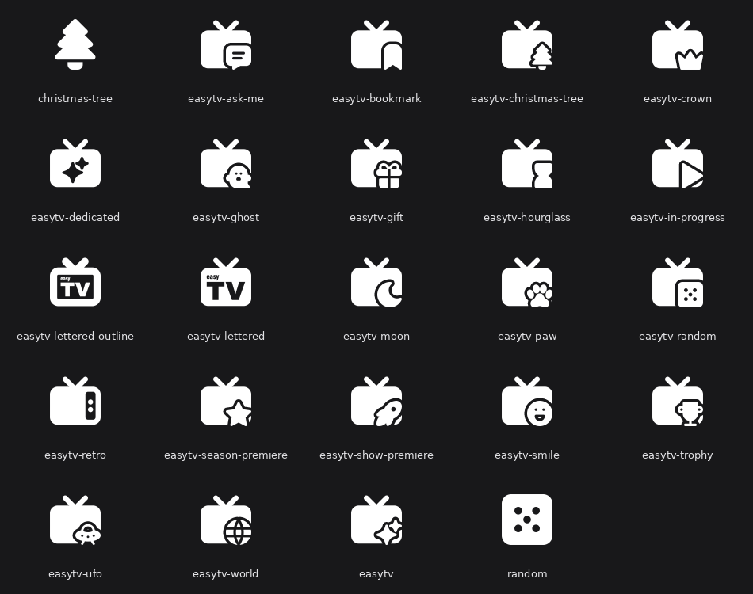

# Menu Icons

EasyTV ships a set of white menu icons for your skin's home menu, so EasyTV and each of its clones can have an icon that looks like it belongs to the same family. Using them is optional: EasyTV works the same without them.



---

## What You Get

Every icon is a TV with a small badge in the bottom-right corner, so a row of EasyTV entries reads as one group while each stays recognisable.

| Icon | Suggested use |
|------|---------------|
| `easytv` | EasyTV itself (TV with sparkles) |
| `easytv-dedicated` | EasyTV itself, with the sparkles cut out of the screen instead of a badge |
| `easytv-lettered` | EasyTV itself, with the "easy TV" wordmark from the add-on icon cut out of the screen |
| `easytv-lettered-outline` | As above, with the wordmark in an outlined screen |
| `easytv-in-progress` | A clone for shows you have started (play badge) |
| `easytv-season-premiere` | A clone for season premieres (star badge) |
| `easytv-show-premiere` | A clone for brand-new shows (rocket badge) |
| `easytv-ask-me` | A clone that uses [Guided Questions](guided-questions.md) (speech-bubble badge) |
| `easytv-random` | A clone for a random playlist (die badge) |
| `easytv-retro` | An old-style TV with no badge |
| `easytv-bookmark`, `-christmas-tree`, `-crown`, `-ghost`, `-gift`, `-hourglass`, `-moon`, `-paw`, `-smile`, `-trophy`, `-ufo`, `-world` | Spare badges for clones of your own (holiday, comedy, horror, sci-fi, short episodes, late night, and so on) |
| `random`, `christmas-tree` | A plain die and a plain tree, without the TV, for other menu entries such as a random playlist or a seasonal smart playlist |

The lettered icons show the wordmark clearly from about 40 pixels up. Below that, the text turns into texture, so pick a sparkle icon if your skin shows menu icons small.

---

## Where the Icons Are

The icons are installed with the add-on, in:

```
special://home/addons/script.easytv/resources/icons/menu/
```

`special://home` is Kodi's own data folder. On disk that is:

| Platform | Folder |
|----------|--------|
| Windows | `%APPDATA%\Kodi\addons\script.easytv\resources\icons\menu\` |
| Linux | `~/.kodi/addons/script.easytv/resources/icons/menu/` |
| LibreELEC / CoreELEC | `/storage/.kodi/addons/script.easytv/resources/icons/menu/` |
| Android | `Android/data/org.xbmc.kodi/files/.kodi/addons/script.easytv/resources/icons/menu/` |
| macOS | `~/Library/Application Support/Kodi/addons/script.easytv/resources/icons/menu/` |

Each [clone](clones.md) carries its own copy of the same icons in its own add-on folder (for example `special://home/addons/script.easytv.kids_tv/resources/icons/menu/`). Pointing every menu entry at the main EasyTV folder is simplest, because that folder stays in place for as long as EasyTV is installed. An add-on update replaces the files in it, so do not edit them there; copy an icon elsewhere first if you want to change it.

---

## Using an Icon in Your Menu

1. Open your skin's menu editor from the skin settings (in Arctic Zephyr Mod it is **Customise home menu**; other skins name it differently).
2. Select the EasyTV or clone menu item.
3. Choose the option to set a custom icon or thumbnail. With Skin Shortcuts, which many skins use for their menus, this opens Kodi's standard image browser.
4. Browse to the folder above and pick the icon.

Every folder in the table above is a hidden folder (`.kodi`, `AppData`, `Library`). If the image browser does not show it, turn on **Settings → Media → General → Show hidden files and directories** first.

### How the Icons Look

The icons are white on a transparent background, the same format skins use for their own menu icons. Skins that tint their icons (with a theme or highlight colour) tint these as well. They are drawn to the same size as the icons in skins such as Arctic Zephyr Mod, so they line up with the skin's own entries.

---

## Troubleshooting

| What you see | Likely cause | Fix |
|--------------|--------------|-----|
| The `.kodi`, `AppData` or `Library` folder does not appear in the image browser | Kodi hides hidden folders by default | Turn on **Settings → Media → General → Show hidden files and directories** |
| The icon disappeared after removing a clone | The menu entry pointed at that clone's own add-on folder, which is removed with the clone | Point the entry at the main EasyTV folder instead |

---

## Credits

The icons are built from [Tabler Icons](https://tabler.io/icons) (MIT licence); the licence text ships next to them as `LICENSE-tabler-icons.txt`. The wordmark on the lettered icons uses the same fonts as the EasyTV add-on icon.

---

## Related Pages

- [Clones](clones.md): create the extra EasyTV entries these icons are designed for
- [Guided Questions](guided-questions.md)
